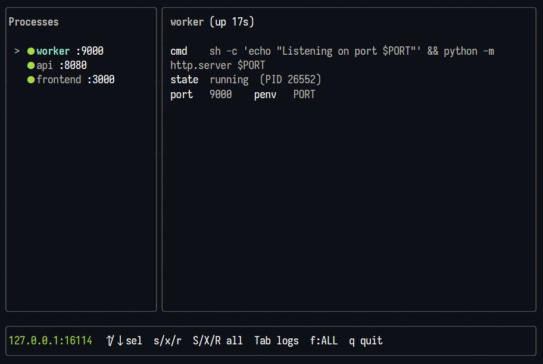
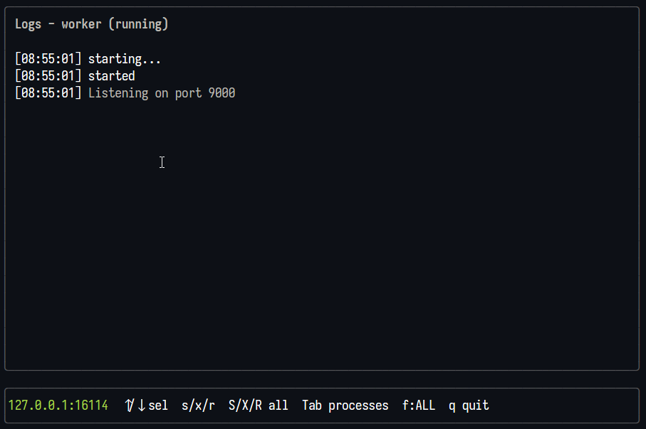

# Invincible

<p align="center">
  <strong>Local development process manager built for humans and autonomous AI agents.</strong><br />
  Keep services alive, restart them on crash, auto-assign free ports, wire up dependencies, and stream logs.<br />
  Native two-layer port isolation enables seamless parallel execution across git worktrees with zero port conflicts.
</p>

<p align="center">
  <a href="LICENSE"></a>
  <a href="https://github.com/saintedlama/invincible/releases"></a>
  <a href="https://github.com/saintedlama/invincible/actions/workflows/ci.yml"></a>
  <a href="https://github.com/saintedlama/invincible"></a>
  <a href="#-multi-agent--worktree-workflows"></a>
</p>

<p align="center">
  <a href="#-quickstart">⚡ Quickstart</a> •
  <a href="#-why-invincible">✨ Why Invincible?</a> •
  <a href="#-what-invincible-is-not">🚫 What It's Not</a> •
  <a href="#-multi-agent--worktree-workflows">🤖 Multi-Agent & Worktrees</a> •
  <a href="#-configuration">⚙️ Configuration</a> •
  <a href="#-terminal-ui">📊 Terminal UI</a> •
  <a href="#-agent-skill--http-api">🔌 Agent Skill & API</a>
</p>

---





---

## ✨ Why Invincible?

When developing microservices, full-stack applications, or orchestrating autonomous AI agents, running dev processes locally is messy. Docker adds virtualization overhead and slow feedback loops; shell scripts leave zombie processes behind; and running parallel git branches inevitably leads to port collision headaches.

Invincible runs directly on your machine as a single, lightweight binary with zero container sprawl:

- 🤖 **Built for Multi-Agent Worktrees (Parallelism Superpower)** — Run $N$ parallel git worktrees or agent branches concurrently on the same machine. Each worktree automatically gets its own non-colliding control API and service ports without any configuration changes.
- 🛡️ **Two-Layer Port Isolation** — Combines path-deterministic hashing for the supervisor control plane with upward free-port scanning for child processes.
- ⚡ **Zero-Config Agent Discovery** — Agents simply read `.invincible.port` in their workspace root to immediately inspect, test, and restart their dedicated service stack.
- 🔄 **Automatic Crash Recovery & Cascade Restarts** — Restarts crashed processes instantly. If a dependent service changes ports on restart, dependents are automatically updated with the new port and rebooted in graph order.
- 🛠️ **File Watching with Chained Builds** — Recompiles code on change and gracefully restarts services only when the build succeeds.
- 🖥️ **Dual Interface: TUI + HTTP API** — An interactive Bubble Tea terminal UI for developers and an OpenAPI-documented REST API for AI agents and automation.

---

## 🚫 What Invincible is NOT

Being purpose-built for local development and autonomous agent workflows means making deliberate architectural boundaries. Invincible is intentionally **not**:

- **A production orchestrator or init system** — Not a replacement for `systemd`, `supervisord`, Kubernetes, or Nomad. Invincible is optimized for interactive developer loops, instant crash recovery, and ephemeral local sessions on your machine.
- **A container runtime or virtualization layer** — Not Docker or Podman. Processes run bare-metal on your host OS for zero startup latency, maximum execution speed, and direct debugger attachment.
- **A build system or task runner** — Not `make`, `just`, `cargo`, or `turbo`. While Invincible coordinates chained pre-restart build steps on file changes, it leaves task execution and compilation logic to your project's native toolchains.

---

## ⚡ Quickstart

### Installation

Requires Go 1.26 or later:

```sh
# Install to $GOPATH/bin
go install github.com/saintedlama/invincible/cmd/invincible@latest
```

Or build from source:

```sh
git clone https://github.com/saintedlama/invincible
cd invincible
go build -o invincible ./cmd/invincible
```

### Starting your stack

```sh
# 1. Initialize a starter configuration in the current directory
invincible init

# 2. Edit .invincible.toml, then launch Invincible
invincible
```

Run headless (no terminal UI, ideal for background services or CI/agent environments):

```sh
invincible --no-tui
```

---

## 🤖 Multi-Agent & Worktree Workflows

### The Multi-Worktree Challenge

When humans and AI agents work simultaneously across multiple git worktrees (e.g., `main`, `fix-auth-race`, `feat-billing`), running local development stacks normally breaks:

1. **Port Collisions:** Both worktrees try to bind `:8080`, `:3000`, or `:5432`. One fails to start or hijacks traffic from the other.
2. **Control Ambiguity:** AI agents cannot identify which dev server belongs to their branch without manual port configuration.
3. **Configuration Drift:** Manually modifying `.env` or port configurations in every worktree is error-prone and risks accidental commits.

### How Invincible Solves This: Two-Layer Isolation

Invincible handles multi-worktree parallelism automatically through a two-layer collision avoidance architecture:

```
  Git Worktree: main                          Git Worktree: feat-auth
  (Primary Developer / Agent A)               (Autonomous Subagent / Agent B)
  Root: /repo/main                            Root: /repo/feat-auth
  ───────────────────────────────────────     ───────────────────────────────────────
  Layer 1: Supervisor Control API             Layer 1: Supervisor Control API
    .invincible.port  ──► 127.0.0.1:8912        .invincible.port  ──► 127.0.0.1:14205
    (path hash: 7777 + offset 1135)             (path hash: 7777 + offset 6428)

  Layer 2: Supervised Child Services          Layer 2: Supervised Child Services
    ├─ api     :8080 (hint)                     ├─ api     :8081 (auto-shifted!)
    ├─ web     :3000 (hint)                     ├─ web     :3001 (auto-shifted!)
    └─ worker  (no-port)                        └─ worker  (no-port)

  Injected Environment:                       Injected Environment:
    PORT=8080, WEB_PORT=3000                    PORT=8081, WEB_PORT=3001
  ───────────────────────────────────────     ───────────────────────────────────────
  ✓ Zero port collisions                      ✓ Zero config changes or manual flags
  ✓ Agent A controls main                     ✓ Agent B controls feat-auth
```

#### Layer 1: Deterministic Control API & `.invincible.port`
- **Path-Derived Preferred Port:** When no explicit `--api-addr` is passed, Invincible hashes the absolute path of the workspace using FNV-1a to derive a deterministic port offset:
  $$\text{Port} = 7777 + (\text{fnv32a}(\text{absPath}) \bmod 10000)$$
  Because worktrees live in different filesystem directories, each worktree automatically picks a different preferred API port (between `7777` and `17776`).
- **`.invincible.port` Discovery File:** On startup, Invincible writes the exact bound address (e.g. `127.0.0.1:14205`) to `.invincible.port` in the worktree root. The file is cleaned up on shutdown and is ignored by git.
- **Agent Handshake:** An AI agent or subagent running in any worktree reads `.invincible.port` from its current working directory. It never needs hardcoded ports or discovery flags.
- **Ephemeral Fallback:** If a preferred port happens to be in use, Invincible automatically falls back to an OS-assigned ephemeral port (`:0`) and records the final address in `.invincible.port`.

#### Layer 2: Child Service Upward Port Scanning
- When processes specify a preferred port (e.g. `port = 8080`), Invincible checks whether the port is free via non-blocking TCP probing.
- If another worktree is already using port `8080`, Invincible automatically increments upward (`8081`, `8082`, ...) until an open port is located.
- The assigned port is dynamically injected into child processes via `PORT` (or `port_env`) and sibling ports via `<PEER_NAME>_PORT` (e.g. `API_PORT`).

---

## ⚙️ Configuration

Invincible loads `.invincible.toml` from the current working directory by default (or via `--config <path>`).

```toml
[project]
name    = "myapp"
# api_addr = ":7777"   # override the HTTP API port (default: path-derived offset from 7777)
# shell    = "auto"    # interpreter for cmd/build: "auto" (bash on Unix, pwsh/cmd on Windows), "cmd", "bash", "pwsh"

[[process]]
name          = "api"
cmd           = "go run ./cmd/api"
cwd           = "./backend"   # working directory for this process
port          = 8080          # hint; Invincible finds the next free port if taken
# port_env    = "PORT"        # env var injected with this process's port (default: PORT)
# no_port     = true          # disable port assignment for this process
# depends_on  = ["worker"]    # restart this process if a dependency changes port
# restart_delay = "500ms"     # wait before restarting after a crash (default: 500ms)
# shutdown_timeout = "500ms"  # SIGTERM grace period before SIGKILL (default: 500ms)
# env         = { QUEUE = "default" }  # extra static env vars

[[process]]
name = "worker"
cmd  = "go run ./cmd/worker"
# port omitted → Invincible assigns an arbitrary free port
```

### Shell selection

Each `cmd` string and each `build` step is run through an interpreter, configured by `project.shell`:

| Value | Behavior |
|---|---|
| `auto` (default) | `bash` on Linux/macOS. On Windows: `pwsh` if found on `PATH`, otherwise `cmd.exe` |
| `cmd` | `cmd.exe /c "..."` — Windows only |
| `bash` | `bash -c "..."` |
| `pwsh` | `pwsh -NoProfile -Command "..."` — PowerShell **7+** only |

### Port assignment & environment variables

Every process that needs a port gets one automatically:
- If `port` is set, Invincible scans upward starting from that hint until an available port is found.
- If `port` is omitted, the OS assigns an arbitrary free ephemeral port.
- Set `no_port = true` to opt out of port allocation.

Before launching each process, Invincible injects:
| Variable | Value |
|---|---|
| `PORT` (or `port_env`) | This process's assigned port |
| `<PEER_NAME>_PORT` | One variable per sibling process with a port, e.g. `API_PORT=8080` |

### Dependency graph & restart cascades

```toml
[[process]]
name       = "frontend"
cmd        = "npm run dev"
depends_on = ["api"]
```

Processes are started in topological dependency order. If `api` crashes and receives a **new port** upon restarting, `frontend` is automatically restarted with the updated `API_PORT`. If the port remains unchanged, `frontend` is left running undisturbed. Cycles are detected at startup and rejected.

### File watching & auto-rebuild (opt-in)

Invincible watches specified directories for changes and triggers debounced restarts or rebuilds:

- **Compiled languages (Go, Rust, etc.):** Set `build` steps. Invincible runs them first as a single chained shell invocation (`step1 && step2`) and only restarts the process upon success. If compilation fails, the previous process continues serving traffic.
- **Interpreted runtimes (Node, Python, etc.):** Omit `build` to restart immediately on file changes.

```toml
[[process]]
name          = "api"
cmd           = "./bin/api"
cwd           = "./backend"
build         = ["go generate ./...", "go build -o ./bin/api ./cmd/api"]
watch         = ["."]
watch_include = ["*.go", "*.templ"]
watch_exclude = ["vendor", ".git", "tmp"]
watch_debounce = "500ms"
```

### Complete configuration reference

```toml
[project]
name     = "myapp"    # optional project display name
api_addr = ":7777"    # override HTTP API bind address (default: path-derived offset from :7777)
shell    = "auto"     # interpreter: "auto" | "cmd" | "bash" | "pwsh" (default: "auto")

[[process]]
name             = "api"                             # required, unique identifier
cmd              = "go run ./cmd/api"                # required command line
cwd              = "./backend"                       # working directory (default: project root)
port             = 8080                              # port hint; scans upward if occupied
port_env         = "PORT"                            # env var name for own port (default: "PORT")
no_port          = false                             # true disables port allocation
depends_on       = ["worker"]                        # cascade-restart if dependency port changes
restart_delay    = "500ms"                           # delay before restarting crashed process (default: 500ms)
shutdown_timeout = "500ms"                           # SIGTERM grace period before SIGKILL (default: 500ms)
env              = { QUEUE = "default", LOG_LEVEL = "debug" }  # custom env vars

# Optional file watching
watch          = ["."]                                # directories to monitor
watch_include  = ["*.go", "*.templ"]                  # file glob filter (default: all files)
watch_exclude  = ["vendor", ".git", "tmp"]             # subdirectories to ignore
watch_debounce = "500ms"                               # quiet duration before rebuild (default: 500ms)
build          = ["go generate ./...", "go build -o ./bin/api ./cmd/api"] # chained pre-restart build steps

[[process]]
name    = "worker"
cmd     = "python worker.py"
cwd     = "./worker"
no_port = true
watch   = ["."]
```

---

## 📊 Terminal UI

Invincible features a high-performance Bubble Tea terminal UI with dual screens: **Dashboard** (process status & details) and **Logs** (full-width streaming logs).

| Key | Action |
|---|---|
| `Tab` | Toggle between Dashboard and Logs screens |
| `p` | Switch to Dashboard screen |
| `l` | Switch to Logs screen |
| `↑` / `k` | Select previous process |
| `↓` / `j` | Select next process |
| `s` | Start selected process |
| `x` | Stop selected process |
| `r` | Restart selected process |
| `S` (Shift+s) | Start all processes |
| `X` (Shift+x) | Stop all processes |
| `R` (Shift+r) | Restart all processes |
| `f` | Cycle log filter (`ALL` → `STDERR` → `STDOUT` → `INVINCIBLE`) |
| `Shift+↑` / `PgUp` | Scroll logs up |
| `Shift+↓` / `PgDown` | Scroll logs down |
| `q` / `Ctrl+C` | Quit |

### Mouse support
- **Scroll wheel:** Navigates processes on the Dashboard and scrolls output on the Logs screen.
- **Copying text:** Hold **Shift** while dragging to select and copy text using native terminal selection.

---

## 🔌 Agent Skill & HTTP API

Invincible includes a built-in skill specification for AI assistants (Claude Code, Cursor, Copilot Workspace, custom agentic frameworks).

### Agent skill setup

```sh
# Print instructions for installing the skill into an agent
invincible skill

# Print full skill description and OpenAPI documentation for agents
invincible skill-spec
```

### HTTP REST API

The HTTP API binds to `127.0.0.1` only. Discover the active address in any worktree via `cat .invincible.port`.

| Method | Path | Description |
|---|---|---|
| `GET` | `/processes` | List all processes and statuses |
| `GET` | `/processes/{name}` | Get single process details |
| `GET` | `/processes/{name}/logs` | Tail recent logs (`?n=100&format=text`) |
| `POST` | `/processes/{name}/start` | Start a process |
| `POST` | `/processes/{name}/stop` | Stop a process |
| `POST` | `/processes/{name}/restart` | Restart a process |
| `POST` | `/processes/restart-all` | Restart all processes |
| `GET` | `/openapi.json` | Full OpenAPI 3.0 specification |

### Process object schema

```json
{
  "Name":       "api",
  "State":      "running",
  "PID":        1234,
  "Cmd":        "go run ./cmd/api",
  "Cwd":        "./backend",
  "Port":       8080,
  "PortEnv":    "PORT",
  "DependsOn":  ["worker"],
  "Restarts":   0,
  "StartedAt":  "2026-06-04T08:00:00Z",
  "Watching":   true,
  "Env":        { "QUEUE": "default" }
}
```

**Process states:** `stopped` · `starting` · `probing` · `running` · `building` · `crashed`

- `probing`: The process is running but has not yet accepted a TCP connection on its assigned port. Transitions to `running` once reachable.
- `building`: File change triggered a rebuild; existing process continues serving traffic until the build succeeds.

### Log entries

```json
{
  "time": "2026-06-04T08:22:01Z",
  "line": "server started on :8080",
  "source": "stdout"
}
```

Log sources: `stdout`, `stderr`, or `invincible` (system & build messages). Append `?format=text` for plain newline-delimited output.
